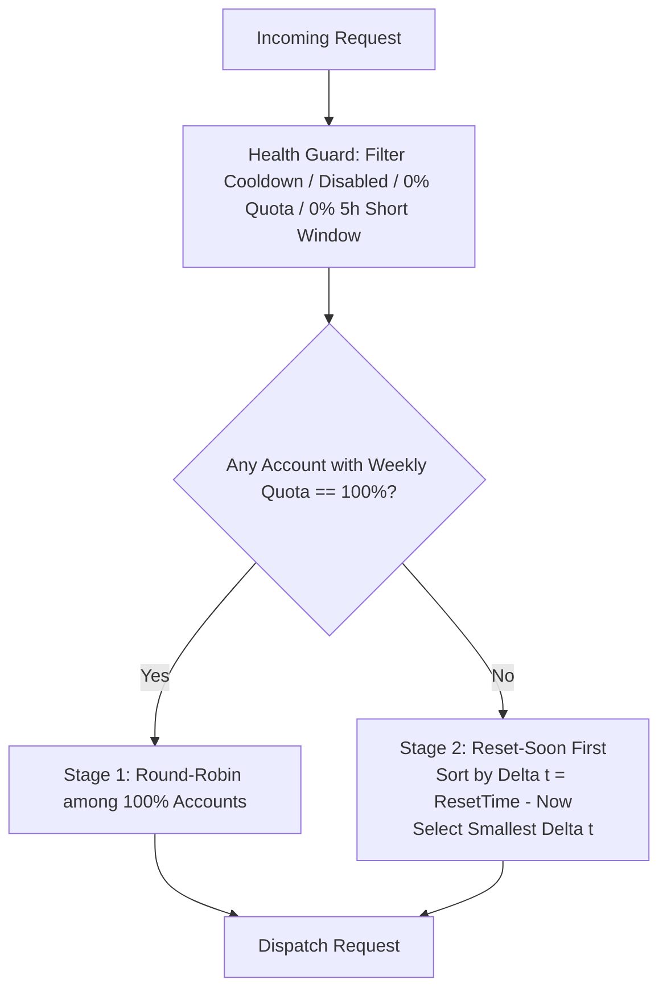
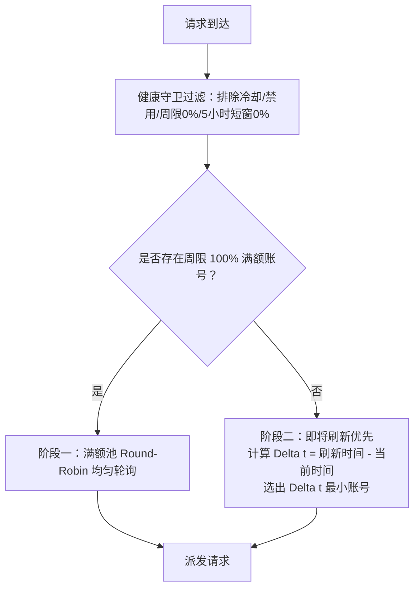

# 智能配额轮换调度器 / Smart Quota Rotator (`cpa-plugin-quota-rotator`)

<p align="center">
  <b>A native dynamic scheduler plugin for <a href="https://github.com/router-for-me/CLIProxyAPI">CLIProxyAPI</a></b><br>
  <b>满额自动负载均衡，临期优先榨干重置，支持多号并行防打爆</b>
</p>

<p align="center">
  <a href="#quick-overview">Quick Overview</a> &bull;
  <a href="#english-documentation">English Documentation</a> &bull;
  <a href="#chinese-documentation">中文说明</a> &bull;
  <a href="README.zh-CN.md">独立中文文档 (README.zh-CN.md)</a>
</p>

<p align="center">
  
  
  
  
</p>

---

<a name="quick-overview"></a>
### ⚡ 核心功能与适用人群 (Quick Overview)

#### 🇨🇳 中文简介
> **CLIProxyAPI 智能配额轮换调度器：满额自动负载均衡，临期优先榨干重置，支持多号并行防打爆。**

- **核心三大功能**：
  1. **满额轮询（100%）**：账号周额度 100% 时自动均匀分摊，避免单号过早耗尽。
  2. **临期优先（≤99%）**：全员降至 ≤99% 时，优先消耗距离刷新倒计时最短的账号，榨干即将重置的过期额度。
  3. **智能避让与锁定**：额度耗尽（0%）或短窗用尽自动跳过；支持多号并行防打爆与手动锁定指定账号优先级。
- **最适合什么人用？**
  1. **多账号持有者**：拥有 3 个或更多 Codex / Antigravity 账号，发愁周额度到期刷新前未用完被浪费。
  2. **重度写代码用户**：Cursor / Cline / Codex CLI 高频调用者，需要稳定高可用与无感自动切号，告别手动盯倒计时。
  3. **高并发与防风控需求者**：开启多号并行（如设置 2~3 个号同时跑），既能快速消耗临期额度，又能分摊单号 RPM 并发压力，防止触发 429 限流。

#### 🇬🇧 English Overview
> **Smart Quota Rotator for CLIProxyAPI: Full-capacity load balancing, reset-soon first quota drain, and multi-account parallel protection.**

- **3 Core Capabilities**:
  1. **Full-Capacity Round-Robin (100%)**: Balances requests evenly across 100% accounts to prevent premature depletion.
  2. **Reset-Soon First (≤99%)**: Prioritizes accounts closest to weekly reset when all drop to ≤99%, draining expiring quota before renewal.
  3. **Smart Bypass & Pin**: Automatically bypasses 0% exhausted or rate-limited accounts; supports parallel dispatch and pinned account priorities.
- **Who Is It For?**
  1. **Multi-Account Users**: Managing 3+ Codex / Antigravity accounts who want to stop wasting expiring weekly quotas.
  2. **Heavy Coding Developers**: Power users of Cursor, Cline, and Codex CLI who need automated, reliable failover without manual switching.
  3. **High-Concurrency Users**: Developers who need parallel consumption across multiple accounts to absorb bursts while avoiding 429 rate limits.

---

<a name="english-documentation"></a>
## English Documentation

### 💡 Purpose & Key Benefits (Why Do You Need This?)

#### 1. Background & Problem It Solves (Purpose)
In multi-account subscription pools (e.g. multiple OpenAI/Codex or Google/Antigravity accounts), default schedulers (such as simple round-robin or static priority) cause two critical issues:
- **Expiring Quotas Get Wasted**: Accounts that are only hours away from their weekly reset often sit with unused quota while fresh accounts are consumed unnecessarily. When the reset occurs, that unused quota simply vanishes.
- **5-Hour Short-Window 429s**: Blind round-robin or sticky routing does not protect accounts when their 5-hour short window is exhausted (100% utilized), causing immediate upstream 429 rate-limit errors and account cooldowns.

`cpa-plugin-quota-rotator` solves this by introducing a native, two-stage **Reset-Soon First (即将刷新优先)** state machine that calculates the exact countdown to weekly reset for every account.

#### 2. Key Benefits & Advantages
- 🎯 **Zero Wasted Quota (Maximize Value)**:
  When all healthy accounts decrease to <=99%, traffic is immediately concentrated on the account with the shortest countdown until weekly reset ($\Delta t = \text{ResetTime} - \text{Now}$). It aggressively drains expiring quotas before they refresh, giving you maximum value from your subscriptions.
- 🛡️ **Proactive 429 & Rate-Limit Avoidance (Health Guard)**:
  Built-in Health Guard constantly monitors both weekly quota and 5-hour short windows. Any account with 0% short window or 0% weekly quota is instantly and strictly bypassed, preventing request failures and upstream cooldown penalties.
- ⚡ **100% Autonomous & Zero Maintenance**:
  Transitions between full-capacity round-robin and reset-soon concentration happen seamlessly in memory with microsecond latency. As soon as an account resets back to 100%, the rotator automatically reverts to full-capacity routing without requiring manual priority tweaks.
- 🌐 **Multi-Provider & Multi-Model Ready**:
  Seamlessly coordinates Codex (ChatGPT Team/Enterprise/Plus accounts) and Antigravity (Gemini/Claude account groups).

---

### Core Mechanisms & Decision Logic (`scheduler.pick`)



1. **Hard Health Filtering**:
   - Accounts with `WeeklyRemainingPercent == 0` are excluded.
   - If `strict_short_window: true`, accounts with `ShortWindowRemainingPercent == 0` (5-hour window fully used) are excluded.
   - Accounts in Cooldown or Disabled states are excluded.
2. **Two-Stage Selection Tree**:
   - **Stage 1 (100% Full-Capacity Pool)**: If one or more accounts retain 100% weekly quota, requests alternate evenly across them via Round-Robin.
   - **Stage 2 (<=99% Reset-Soon First Pool)**: When all available accounts have dropped to [1%, 99%], the algorithm computes $\Delta t = \text{ResetTime} - \text{Now}$ for each candidate. The account with the shortest reset countdown receives 100% priority.
   - **Dynamic Failover**: If the active candidate exhausts its 5h short window or hits 0% weekly quota mid-stream, it is instantly bypassed and traffic seamlessly transfers to the account with the next shortest reset countdown.
   - **State Reset**: When an account reaches its weekly reset timestamp and recovers to 100%, the system immediately reverts to Stage 1.

---

### Configuration (`config.yaml`)

Add the following to your CLIProxyAPI `config.yaml`:

```yaml
plugins:
  enabled: true
  configs:
    quota-rotator:
      enabled: true                     # Master toggle for automatic priority rotation
      strict_short_window: true         # Strict bypass when 5-hour short window is 0% (default: true)
      refresh_interval: "10m"           # Background asynchronous quota polling interval
      providers:                        # Providers where rotation takes effect
        - "codex"
        - "antigravity"
      antigravity_group: "gemini"       # Model group for Antigravity (e.g. gemini, claude_gpt)
```

---

### Management & Diagnostic API

The plugin provides a live status endpoint registered into the CLIProxyAPI Management API:

```http
GET /v0/management/plugins/quota-rotator/status
```

---

### Verification & Tests

The core scheduling logic has been thoroughly verified through unit tests and automated simulations:
- `TestRotator_Scenario1_FullCapacityRoundRobin`: Verifies uniform Round-Robin among 100% accounts.
- `TestRotator_Scenario2_ResetSoonPriorityAt99Percent`: Verifies switch to Reset-Soon First when accounts fall to <=99%.
- `TestRotator_Scenario3_BypassOnZeroQuotaOrShortWindow`: Verifies instant bypass when 5h short window or weekly quota hits 0%.
- `TestRotator_Scenario4_RecoveryToStageOneWhenAccountResets`: Verifies instant recovery to Stage 1 when an account resets to 100%.

Run simulation tests locally:
```bash
python tests/test_simulation.py
```

---

<a name="chinese-documentation"></a>
## 中文说明 (Chinese Documentation)

### 💡 核心作用与实际好处 (Purpose & Key Benefits)

#### 1. 为什么需要此插件？（核心作用与解决痛点）
在多账号订阅池（例如多个 OpenAI Codex 或 Google Antigravity 订阅账号）的高频调用场景下，CPA 原生的轮询（Round-Robin）或固定优先级（Priority）调度存在两大核心痛点：
- **即将过期的配额被白白浪费**：许多账号距离每周刷新重置仅剩几小时甚至几十分钟，由于缺乏感知倒计时的机制，这些额度未被充分消耗就直接被系统刷新覆盖，造成周限配额的巨大浪费；而刚刚刷新的全新额度却被过早消耗。
- **短窗超限易导致 429 报错**：普通轮询无法精准管控 5 小时短窗（Short Window）耗尽情况，容易强行向短窗已耗尽的账号派发请求，从而触发服务商的 429 速率限制（Rate Limit）或账号冷却惩罚。

`cpa-plugin-quota-rotator` 基于两阶段状态机彻底解决了这一问题：**满额账号（100%）在池中均匀轮询保底；当账号都被使用（周限降至 99% 及以下）后，系统自动计算刷新倒计时，全力优先消耗刷新时间最近的账号，并在额度耗尽或短窗用尽时瞬间避让**。

#### 2. 核心优势与实际好处 (Key Benefits)
- 🎯 **配额零浪费，订阅价值最大化 (Zero Wasted Quota)**：
  自动计算所有可用账号距离下次周限刷新的倒计时（$\Delta t = \text{ResetTime} - \text{Now}$），将流量全力倾斜至倒计时最短的账号。在刷新前将“即将过期的额度”尽可能榨干用尽，杜绝额度过期浪费。
- 🛡️ **硬性短窗避让，杜绝 429 报错 (Strict 429 & Rate-Limit Protection)**：
  内置健康守卫（Health Guard）硬性检测 5 小时短窗使用率。一旦账号短窗用尽（0% 剩余）或周限归零，立即触发毫秒级避让降级，绝不派发请求，彻底告别频繁 429 报错。
- ⚡ **全自动无感流转，零人工维护成本 (Fully Automated & Zero Maintenance)**：
  决策过程全在内存中以微秒级完成，无需管理员手动频繁修改每个账号的优先级数值。某账号到达重置点并恢复为 100% 满额后，系统自动回退复位至阶段一，全天候稳定运转。
- 🌐 **多渠道订阅池深度适配 (Multi-Provider Support)**：
  原生适配 Codex（ChatGPT Team / Enterprise / Plus 订阅池）与 Antigravity（Gemini / Claude 等模型组），保障高并发多账号协作更稳定高效。

---

### 核心机制与调度规则 (`scheduler.pick`)



1. **硬前置健康过滤**：
   - 检查 5 小时短窗（`primary_window`），若使用率达 100%（剩余为 0%），开启 `strict_short_window: true` 时直接剔除；
   - 周限剩余比例为 0%（完全耗尽）的账号直接剔除；
   - 处于 Cooldown 冷却、Disabled 禁用或 Unauthorized 异常的凭据直接剔除。
2. **两阶段优先级决策树**：
   - **阶段一（100% 满额池）**：筛选周限剩余为 100% 的账号集合 $U_{100}$。若 $U_{100} \neq \emptyset$，采用 Round-Robin 轮询选出目标账号并派发；
   - **阶段二（<=99% 即将刷新优先池）**：若 $U_{100} == \emptyset$，当前池内所有可用账号的周限均在 [1%, 99%] 区间。针对每个可用账号计算周限刷新剩余时间：
     $$\Delta t = \text{ResetTime} - \text{Now}$$
     排序规则为 $\Delta t$ 越小（刷新倒计时越短），优先级绝对最高。
   - **流量集中与动态切换**：请求全力导向 $\Delta t$ 最小的头部账号；若该账号在请求过程中短窗耗尽或周限降至 0%，自动触发避让，下一次请求瞬间无缝转移至 $\Delta t$ 次小的账号；
   - **到期重置复位**：若某账号到期重置、周限恢复为 100%，系统自动回退至阶段一，重新优先轮询 100% 账号。

---

### 配置说明 (`config.yaml`)

在 CPA 的 `config.yaml` 中配置插件：

```yaml
plugins:
  enabled: true
  configs:
    quota-rotator:
      enabled: true                     # 自动轮换总开关（默认 true）
      strict_short_window: true         # 强制 5 小时短窗耗尽避让保护（默认 true）
      refresh_interval: "10m"           # 配额后台异步刷新频率（默认 10m）
      providers:                        # 生效的渠道列表
        - "codex"
        - "antigravity"
      antigravity_group: "gemini"       # Antigravity 针对的模型分组
```

---

### 管理与诊断接口

插件自动向 CLIProxyAPI 管理接口注册诊断路由：

```http
GET /v0/management/plugins/quota-rotator/status
```

返回当前调度状态机阶段（`stage_1_full` 或 `stage_2_reset_soon`）、各账号周限与短窗剩余百分比、距离下次重置倒计时秒数以及当前健康与避让状态。

---

### 测试验证

核心逻辑包含 4 组关键场景的验证：
1. **满额阶段轮询**：账号 A/B 均为 100%，请求严格在 A 与 B 之间均衡交替；
2. **触发 99% 即将刷新优先**：A 与 B 均降至 99%，A 剩余 3 小时刷新，B 剩余 4 天刷新，流量 100% 优先打给 A；
3. **短窗/周限耗尽即刻避让**：A 剩余 3 小时刷新但 5 小时短窗用尽，调度器立即跳过 A，将流量切到 B；
4. **到期重置复位**：B 刷新恢复为 100%，系统立即跳出倒计时优先，重回满额优先调度 B。

运行本地仿真套件验证：
```bash
python tests/test_simulation.py
```

---

## 许可证 (License)

本项目采用 [MIT License](LICENSE) 许可证开源。
