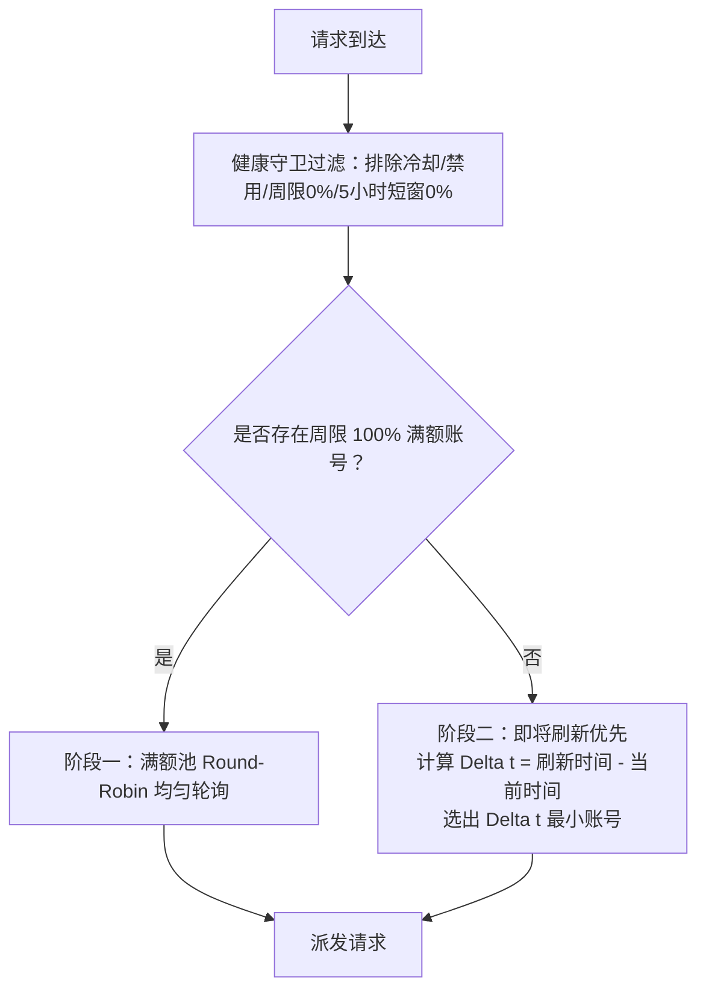

# 智能配额轮换调度器 (Smart Quota Rotator)

> [English Documentation](README.md) | [中文说明](README.zh-CN.md)

适用于 [CLIProxyAPI (CPA)](https://github.com/router-for-me/CLIProxyAPI) 的原生 CGO 动态调度器插件，实现严格的两阶段周限“即将刷新优先（Reset-soon first）”自动轮换机制。

---

### ⚡ 简短介绍

> **CLIProxyAPI 智能配额轮换调度器：满额自动负载均衡，临期优先榨干重置，支持多号并行防打爆。**

- **满额轮询（100%）**：在满额健康账号之间均匀分摊请求。
- **即将刷新优先（≤99%）**：优先使用周限刷新倒计时最短的账号。
- **自定义并行数（`parallel_count`）**：设置前 N 个临期账号并行分摊请求。
- **自动避让与复位**：周限或短窗耗尽时避让，账号重置后自动恢复满额轮询。

### 🎯 适合谁使用？

- 拥有多个 Codex / Antigravity 账号的用户。
- 使用 Cursor、Cline、Codex CLI 的高频开发者。
- 需要多账号并发分摊、减少 429 限流的用户。

---

### 💡 核心作用与实际好处 (Purpose & Key Benefits)

#### 1. 为什么需要此插件？（核心作用与解决痛点）
在多账号订阅池（例如多个 OpenAI Codex 或 Google Antigravity 订阅账号）的高频调用场景下，CPA 原生的轮询（Round-Robin）或固定优先级（Priority）调度存在两大核心痛点：
- **即将过期的配额被白白浪费**：许多账号距离每周刷新重置仅剩几小时甚至几十分钟，由于缺乏感知倒计时的机制，这些额度未被充分消耗就直接被系统刷新覆盖，造成周限配额的巨大浪费；而刚刚刷新的全新额度却被过早消耗。
- **短窗超限易导致 429 报错**：普通轮询无法精准管控 5 小时短窗（Short Window）耗尽情况，容易强行向短窗已耗尽的账号派发请求，从而触发服务商的 429 速率限制（Rate Limit）或账号冷却惩罚。

`cpa-plugin-quota-rotator` 基于两阶段状态机彻底解决了这一问题：**满额账号（100%）在池中均匀轮询保底；当账号都被使用（周限降至 99% 及以下）后，系统自动计算刷新倒计时，全力优先消耗刷新时间最近的账号，并在额度耗尽或短窗用尽时瞬间避让**。

#### 2. 核心优势与实际好处 (Key Benefits)
- 🎯 **配额零浪费，订阅价值最大化 (Zero Wasted Quota)**：
  自动计算所有可用账号距离下次周限刷新的倒计时（$\Delta t = \text{ResetTime} - \text{Now}$），将流量全力倾斜至倒计时最短的账号。在刷新前将“即将过期的额度”尽可能榨干用尽，杜绝额度过期浪费。
- 🛡️ **硬性短窗避让，杜绝 429 报错 (Strict 429 & Rate-Limit Protection)**：
  内置健康守卫（Health Guard）硬性检测 5 小时短窗使用率。一旦账号短窗用尽（0% 剩余）或周限归零，立即触发毫秒级避让降级，绝不派发请求，彻底告别频繁 429 报错。
- ⚡ **全自动无感流转，零人工维护成本 (Fully Automated & Zero Maintenance)**：
  决策过程全在内存中以微秒级完成，无需管理员手动频繁修改每个账号的优先级数值。某账号到达重置点并恢复为 100% 满额后，系统自动回退复位至阶段一，全天候稳定运转。
- 🌐 **多渠道订阅池深度适配 (Multi-Provider Support)**：
  原生适配 Codex（ChatGPT Team / Enterprise / Plus 订阅池）与 Antigravity（Gemini / Claude 等模型组），保障高并发多账号协作更稳定高效。

---

### 核心机制与调度规则 (`scheduler.pick`)



1. **阶段一（100% 满额轮询期）**：
   - 只要账号池中存在周限制额度为 100% 的健康可用账号，所有流量绝对优先打入 100% 账号，并在满额账号之间通过 Round-Robin 均匀轮询。
2. **阶段二（<=99% 即将刷新优先期 / Reset-Soon First）**：
   - 当所有健康可用账号的周限均下降至 99% 及以下（且 >0%）时，自动切换至“即将刷新优先”状态。
   - 算法计算每个账号距离下次周限刷新的倒计时：
     $$\Delta t = \text{ResetTime} - \text{Now}$$
   - 流量全力导入 $\Delta t$ 最小（距离刷新时间最近）的头部账号，最大化利用即将重置的过期额度。
3. **避让与降级保护 (Health Guard)**：
   - 周限彻底耗尽（0%）的账号直接剔除避让。
   - 5 小时短窗耗尽（0% 剩余 / 100% 使用率）的账号在开启 `strict_short_window: true` 时强制剔除避让。
   - 处于 Cooldown（冷却）或 Disabled（禁用）的账号自动剔除避让。
4. **自动复位机制 (Auto Recovery)**：
   - 当某个账号到达刷新周期并恢复为 100% 时，调度器无缝回退至阶段一，重新优先轮询 100% 账号。

---

### 配置说明 (`config.yaml`)

在 CPA `config.yaml` 的 `plugins.configs` 中添加：

```yaml
plugins:
  enabled: true
  configs:
    quota-rotator:
      enabled: true                     # 自动轮换总开关
      strict_short_window: true         # 强制 5 小时短窗耗尽避让保护
      refresh_interval: "10m"           # 配额后台异步刷新频率
      providers:                        # 生效的渠道列表
        - "codex"
        - "antigravity"
      antigravity_group: "gemini"       # Antigravity 针对的模型分组
```

---

### 管理与诊断接口

插件自动向 CLIProxyAPI 管理接口注册诊断路由：

```http
GET /v0/management/plugins/quota-rotator/status
```

返回当前调度状态机阶段（`stage_1_full` 或 `stage_2_reset_soon`）、各账号周限与短窗剩余百分比、距离下次重置倒计时秒数以及当前健康与避让状态。

---

### 测试验证

核心逻辑包含 4 组关键场景的验证：
1. **满额阶段轮询**：账号 A/B 均为 100%，请求严格在 A 与 B 之间均衡交替；
2. **触发 99% 即将刷新优先**：A 与 B 均降至 99%，A 剩余 3 小时刷新，B 剩余 4 天刷新，流量 100% 优先打给 A；
3. **短窗/周限耗尽即刻避让**：A 剩余 3 小时刷新但 5 小时短窗用尽，调度器立即跳过 A，将流量切到 B；
4. **到期重置复位**：B 刷新恢复为 100%，系统立即跳出倒计时优先，重回满额优先调度 B。

运行本地仿真套件验证：
```bash
python tests/test_simulation.py
```

---

## 许可证 (License)

本项目采用 [MIT License](LICENSE) 许可证开源。
